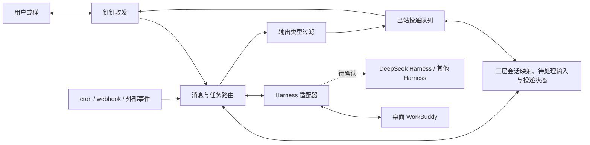

# Agent Courier

Agent Courier 是一个连接钉钉与不同 Harness（Agent 运行系统）的消息中转应用。它负责接收消息和外部事件、关联钉钉会话与 Harness 会话、转交输入、回传结果，以及在用户没有主动发消息时联系用户。

**本项目不实现 Agent 本身。** Agent 在 Harness 中执行任务；模型调用、工具执行、本地文件访问和执行环境由接入的 Harness 提供和管理。

当前状态：需求与技术设计阶段，尚无应用实现。已完成一次桌面 WorkBuddy 本地 Harness 会话互通实验，但没有完成钉钉端到端集成。

首个功能的[规格](specs/001-dingtalk-conversation/spec.md)与
[实施计划](specs/001-dingtalk-conversation/plan.md)限定为文本私聊、持续上下文、运行中及时 steer、
人工问答与单轮多输出。2026-11-05 完成方案研究及设计，选择 TypeScript、Node.js 24 LTS 和 SQLite；
依赖与应用入口尚未落地。安装包静态检查发现 WorkBuddy 的 steer 接收与同轮消费路径，
但未完成已登录真实验证，不能据此声明满足该功能。平台限额和真实能力准入见
[研究记录](specs/001-dingtalk-conversation/research.md)与[验证指南](specs/001-dingtalk-conversation/quickstart.md)。

## 术语与命名

以下是本项目的术语约定，用于区分执行主体、接入系统和不同层的会话。

| 术语 | 本项目中的含义 | 典型用法 |
| --- | --- | --- |
| Agent | 在 Harness 中执行任务的智能体，描述推理、工具使用、回答和提问等行为 | Agent 生成回答、Agent 根据补充输入调整工作 |
| Harness | 承载并驱动 Agent 的运行系统，管理模型与工具调用、操作权限及执行生命周期，并提供外部接入接口 | 接入 Harness、探测 Harness 能力、Harness 返回执行事件 |
| Harness 实例 | 配置中指定的一个 Harness 接入目标；与产品名称、临时进程或连接端点区分 | `HarnessInstance`、`harnessInstanceId` |
| 钉钉会话 | 钉钉中的私聊或群聊；首版只处理私聊。跨平台设计中统称“平台会话” | `PlatformConversation`、钉钉 `conversationId` |
| Courier 会话 | Courier 为一个平台会话保存的本地路由与策略记录，通过绑定找到 Harness 会话；不是另一套 Agent 执行上下文 | `CourierSession`、`courierSessionId` |
| Harness 会话 | 由 Harness 管理、供 Agent 持续执行任务的上下文；续接与写入权均指这一层 | `HarnessBinding.harnessSessionId`、Harness 契约的 `sessionRef` |
| 运行任务（Run） | 一次执行及其状态记录；同一 Harness 会话可先后承载多个 Run，steer 仍作用于当前 Run | Courier 的 `Run.id` 与 Harness 的运行标识分开保存 |

首版将一个钉钉私聊会话映射到一个 Courier 会话，再绑定一个 Harness 会话。
下文的“三层会话映射”专指这组关系；“Harness 绑定”专指 Courier 会话与 Harness 实例、Harness 会话的绑定。
钉钉中展示的机器人身份、执行任务的 Agent 和提供接入接口的 Harness 也分别命名。

写执行行为用 Agent，写接入、认证、能力、事件、权限处理与生命周期接口用 Harness。
例如“Agent 生成回答，Harness 返回对应输出事件，Courier 投递到原钉钉会话”。
“Harness 输出事件”可以包含 Agent 的内容及 Harness 的控制信息，不能把整个事件流统称为“Agent 回答”。
问题来自 Agent，操作授权请求由 Harness 管理并向 Courier 暴露，两者都需关联原运行任务。
本文不假定 Harness 内部的 Agent 数量或厂商角色划分。

涉及路由、状态、持久化、恢复和标识时，使用“钉钉会话／平台会话”“Courier 会话”或“Harness 会话”，
不用未限定的 session、“Agent 会话”或“任务会话”混指它们。对用户的自然语言可以说“继续对话”，
技术描述仍注明续接的是 Harness 会话。代码中的既有字段和厂商原名保持原样，并在契约中标明所属层。
厂商协议中的 agent/client 等角色名也保留原名，按该协议的角色解释，不机械替换成 Harness。
`sessionWebhook` 是钉钉提供的临时回复地址，不是三层会话中的任何一个稳定标识；
`session/new`、`session/load` 等协议方法中的 session 则由 Harness 适配器映射到 Harness 会话。

## 目标与边界

需要支持的使用流程：

1. 用户在钉钉发消息，Agent Courier 将消息送到指定 Harness，并把回答发回正确的用户或群。
2. cron、业务 webhook 或其他外部事件触发 Agent 工作，完成后主动向指定用户发送结果。
3. Agent 在任务中提出问题，或 Harness 发起操作授权请求时，通过钉钉联系用户；用户的回复能回到原运行任务、原 Harness 会话和原待处理问题。
4. 切换或增加 Harness 时，尽量复用消息路由与投递逻辑，通过适配器处理差异。
5. 对支持 Harness 会话续接的 Harness，保留历史上下文；对不支持的能力，明确返回限制，不悄悄新建 Harness 会话冒充续接。
6. 一次用户输入可以产生多条 Agent 输出，包括渐进式进度报告；支持配置哪些输出类型传递给用户，并将选中的内容按需投递为多条消息。

首个已调查目标是**电脑上的 WorkBuddy**，需要使用该机器的本地文件和环境。Agent Courier 与 WorkBuddy 同机运行是已探索的部署方式。

后续还希望接入 **DeepSeek Harness**。其具体产品、运行方式、接口和 Harness 会话能力尚未确认；目前只记录此需求，暂不开展调查。不要把 DeepSeek 模型 API 自动当成这里所指的 Harness。

此阶段不包含模型选型、Agent loop、工具执行器、远端部署或钉钉应用发布。
首个私聊功能已有技术选型，仍未实现或部署；外部事件触发另行编写规格。

## 建议的组件边界

以下是实现方向，不是已经落地的模块或冻结的接口。



| 组件 | 职责 |
| --- | --- |
| 钉钉收发 | 接收用户输入、回复消息、主动发送、平台消息格式转换 |
| 外部事件入口 | 接收事件并携带事件 ID、目标接收人、任务上下文及新建或续接 Harness 会话的选择 |
| 路由与状态 | 维护平台身份与三层会话映射，关联运行任务和待处理问题；处理重复输入、执行串行化与投递状态 |
| 输出类型过滤 | 根据配置决定哪些用户可见输出进入出站投递，不改变任务状态和交互控制 |
| 出站投递 | 合并输出片段、排队、控制发送频率、发送多条消息，并逐条记录结果与处理重试 |
| Harness 适配器 | 发现能力、创建或续接 Harness 会话、提交输入、将厂商输出归一化为事件，并处理 Harness 特有生命周期 |
| Harness | 驱动 Agent 执行任务，提供模型与工具调用、操作权限和本地执行环境 |

实现时需要区分以下标识，不能用一个消息 ID 包办所有关联：平台用户/群、平台会话、Courier 会话、Harness 实例、Harness 会话、运行任务（Run）、外部事件、待处理问题或授权请求、出站投递。

事件触发应明确选择“新建 Harness 会话”或“续接指定 Harness 会话”，并确定接收人。主动发送路径需要在没有近期用户消息的情况下工作，不能依赖一个临时回复地址长期有效。

Harness 会话写入权协调必须覆盖桌面客户端和 Agent Courier。仅在 Agent Courier 内部加锁，并不能让桌面已经持有的写入权自动释放。

## 多次输出与可配置过滤

不能把 Harness 接口建模为“一次输入只返回一个字符串”。同一轮任务可能产生多条用户可见输出，Courier 应持续接收这些输出，根据类型配置决定是否向用户转发。该需求同样适用于外部事件触发的任务。

以下类型仅用于说明设计方向，尚未冻结事件结构；具体映射应以各 Harness 实际提供的语义为准：

| 输出类型示例 | 内容 | 可选转发策略示例 |
| --- | --- | --- |
| `progress` | 阶段性进度，如“已完成资料检索” | 可开启或关闭，发送时可合并相邻进度 |
| `message` | 过程中面向用户的补充说明 | 可单独配置 |
| `tool_status` | 可向用户展示的工具执行状态 | 可关闭以减少消息数量 |
| `final` | 本轮最终回答 | 通常保留 |
| `question` / `permission_request` | 需要用户回答或授权的请求 | 默认保留，并关联待处理问题 |
| `artifact` / `error` | 交付结果或执行错误 | 分别配置，错误默认保留 |

过滤器作用于 Harness 明确提供、允许向用户展示的输出事件。适配器负责统一不同 Harness 的类型，不应仅根据文本内容猜测进度、最终回答或完成状态。过滤配置的作用域和默认值留待接口设计时确定。

过滤只决定内容是否投递给用户。被过滤的展示事件不影响必要的状态更新、任务完成判断和权限控制。若禁用提问或授权请求的转发，必须明确其他人工交互路径或拒绝该配置，不得静默丢弃后让 Agent 无限等待，也不得自动批准权限请求。

逻辑消息与增量输出片段应分开处理：同一条消息的多个片段不应各自变成一条钉钉消息。出站层应支持片段合并、进度合并和发送频率控制，同时保留任务关联与必要的输出顺序。每条出站消息独立记录投递状态；重试发送不得重新执行 Agent 任务。

钉钉接入的验收需要专门覆盖“同一次用户输入 → 多条输出”。当前尚未实测同一 `sessionWebhook` 连续多次回复的行为，也未确认每个地址的累计条数与发送频率限制。不能把“一次输入只能回复一条”或“有效期内可以无限发送”当成已确认的平台能力。实现时还需验证回复地址过期后的发送路径；暂不支持多条投递时，应明确报告限制，或采用用户明确配置的合并策略。

## 协议方向

- **ACP（Agent Client Protocol）**是优先评估的 Harness 会话协议；WorkBuddy 实验使用了本机 HTTP/SSE 上的 ACP JSON-RPC。
- 各 Harness 通过能力声明表达是否支持历史加载、续接、取消、流式输出和用户交互。只有实测支持的能力才对上层开放。
- 外部事件可评估采用 CloudEvents 信封；远端异步任务如有需要，可另评估 A2A。当前没有要求同时实现这些协议。
- MCP 用于工具和数据接入，不作为本项目连接钉钉会话与 Harness 会话的完整聊天协议。

不要将“支持 ACP”推导成“支持任意客户端同时写入同一 Harness 会话”，也不要将 WorkBuddy 云端任务、桌面产品和独立启动的 CodeBuddy CLI 当成同一种 Harness 会话系统。

## WorkBuddy 已验证的行为

### 实验范围

2026-11-04，在 Linux 环境测试桌面 WorkBuddy **5.6.2**，随包 CLI 为 **2.147.0**。仅保留界定兼容性范围所需的平台类别和产品版本，不记录具体主机配置。这些是实验版本记录，不是项目要求固定安装的版本，也不代表未来环境中的最新版本。

实验在已通过官方登录的独立 Harness 测试会话中进行。在桌面创建 Harness 会话与激活运行进程通过临时、本机可访问的 Electron 调试连接调用内部 WorkBuddy SDK；独立 Python 客户端则使用该运行进程的本机 ACP HTTP/SSE 接口。

这证明了指定版本上的技术可行性。桌面内部 SDK、调试接口和诊断得到的端口不是已确认稳定的第三方接入契约。

### 实测结果

| 检查 | 结果 |
| --- | --- |
| 桌面 WorkBuddy 的 Harness 会话接收输入并产生真实 Agent 回复 | 通过 |
| 独立 ACP 客户端加载该 Harness 会话并读到首轮问答 | 通过 |
| 独立客户端续聊，沿用桌面提供的上下文 | 通过 |
| 外部消息和回答自动出现在桌面历史中 | 通过 |
| 独立本地脚本延时触发一轮对话 | 通过；模拟定时事件，未安装 cron job |
| 返回桌面继续聊，复述外部事件中的标识 | 通过 |
| 刷新桌面界面并重新打开该 Harness 会话，恢复四轮历史 | 通过 |
| 桌面持有 Harness 会话写入权时，新的 ACP 客户端再次加载 | 被拒绝，返回 `writer_occupied` |

验证顺序：桌面先给出一个测试标记；独立客户端在不重复提供标记的情况下正确复述；另一个外部事件带入事件 ID；最后桌面正确复述该事件 ID。四轮问答在刷新后仍然存在。

写入权冲突的实际错误为：

```json
{
  "code": -32000,
  "message": "Persistent Session already has an external writer",
  "data": { "reason": "writer_occupied" }
}
```

### 对实现的影响

- 已跑通的消息中转走本机 ACP，无需通过 WorkBuddy 云端消息 OpenAPI 转发；模型推理仍使用配置的模型服务，并不意味着离线运行。
- 需要设计明确的控制权交接，或统一通过持有 Harness 会话写入权的入口提交消息。不能为每条消息随意新建一个 ACP 客户端并假定 `session/load` 总会成功。
- WorkBuddy 会回收空闲运行进程，端口也会改变。运行进程的发现、激活与重连需要单独适配，不能把实验端口写死。
- 一次内部 SDK `runPrompt` 返回了空 `content`，但通知、历史和界面中有完整回答。完成判定与回答提取需要交叉验证，不能只依赖该包装方法的返回值。
- 独立启动一个 CLI 进程能完成 ACP 握手，不等于它自动继承桌面登录状态或拥有桌面 WorkBuddy 的 Harness 会话。

尚未验证：真实钉钉收发和主动通知、权限请求和用户问答的完整往返、多用户隔离、并发和故障恢复、完整应用重启后的恢复、工具执行及本地文件操作。不能把这次实验描述为完整产品端到端验收。

## 在另一环境继续

当前仓库包含项目说明、交接指南、Spec Kit 项目原则、首个功能规格及技术设计。
没有应用包管理配置、服务入口、构建命令或测试套件；不要假定已经存在可运行应用。
Spec Kit 的材料检查脚本不等于应用测试。

获得后续实现任务后，建议按以下顺序推进：

1. 先阅读首个功能的规格与实施计划，按其范围、选型与准入检查继续；不要将外部事件或群聊自动加入首版。
2. 按现有数据模型与适配器契约拆解任务，保留三层会话映射、人工输入、投递和操作结果的独立关联。
3. 先用测试用 Harness 验证本功能的私聊路由、及时 steer、人工答复与投递，再接通过准入的真实 Harness。
4. 对目标 WorkBuddy 版本重新验证 Harness 会话写入权、运行进程发现、登录和恢复行为，明确选用公开接口还是实验性内部适配。
5. 完成本功能真实钉钉私聊的正常与异常验收；外部事件另有规格后，再验证“外部事件 → Agent → 主动联系用户 → 用户回复 → 原任务继续”链路。
6. 用户另行安排 DeepSeek Harness 工作时，再确认其具体对象和接口，补充第二个适配器。

最低验收场景应覆盖重复事件不重复执行、投递重试不重新触发推理、不同平台会话间不混用 Harness 上下文、写入权冲突有明确处理、失效登录可恢复，以及用户回复能关联到正确的待处理输入。输出侧还需覆盖单轮多消息、类型过滤、增量片段合并、输出顺序、单条投递失败后的重试，以及被隐藏的进度不影响最终结果和待处理人工交互。

## 参考入口

以下是前期调查用过的官方入口，实施时应重新核对目标产品和版本：

- [CodeBuddy ACP 协议集成](https://www.codebuddy.cn/docs/cli/acp)
- [CodeBuddy HTTP API](https://www.codebuddy.cn/docs/cli/http-api)
- [WorkBuddy Open API](https://open.workbuddy.cn/docs/openapi)
- [钉钉消息发送说明](https://open-dingtalk.github.io/developerpedia/docs/develop/agent/send-message/)
- [ACP 传输规范](https://agentclientprotocol.com/protocol/v1/transports)

## 许可证与仓库

本项目采用 [MIT 许可证](LICENSE)，公开仓库为 [euyuil/agent-courier](https://github.com/euyuil/agent-courier)。当前仍处于文档与设计阶段，尚无应用发布或部署。
