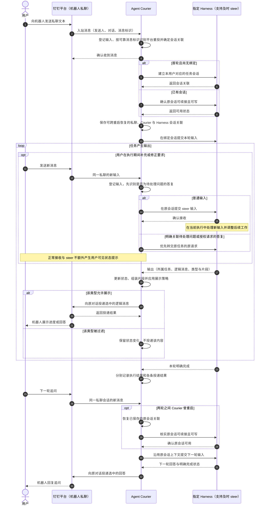
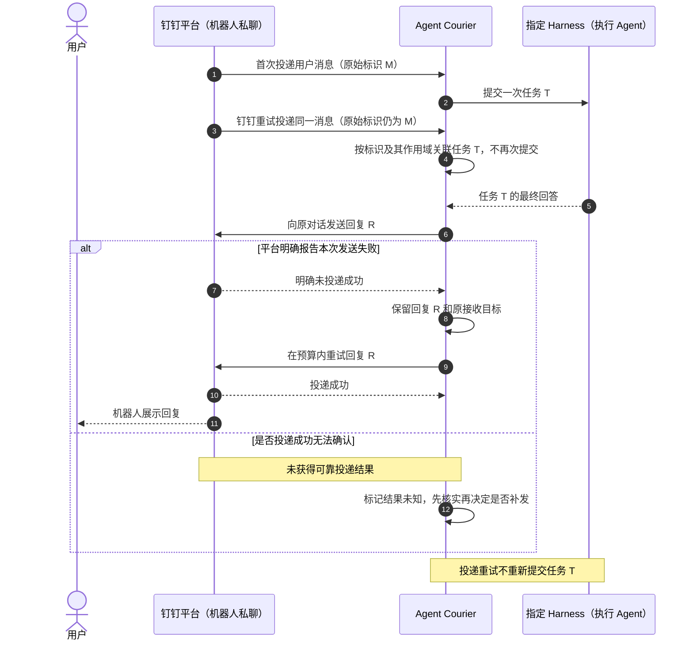
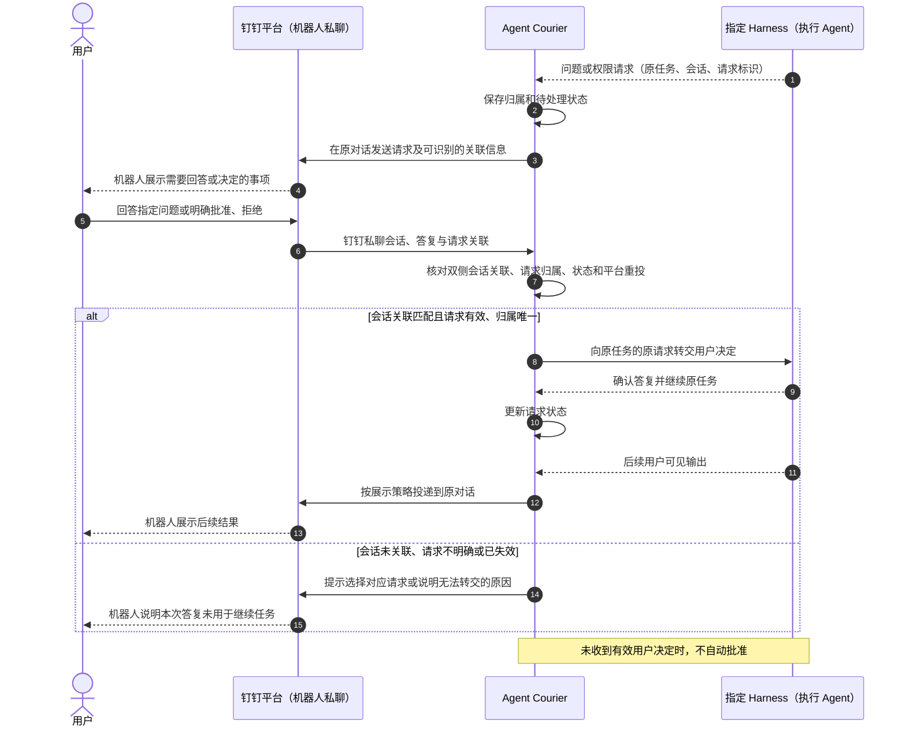

# 功能规格：通过钉钉机器人与指定 Harness 持续对话

**功能分支**：未创建；本次在 `main` 编写，功能目录不依赖分支名称。

**创建日期**：2026-11-05

**状态**：草案；描述目标行为，不代表实现或真实集成已完成。

**输入**：用户要求通过钉钉机器人私聊与指定 Harness 持续对话，覆盖正确路由、上下文续接、
单轮多输出与类型过滤、平台消息重投、投递重试、会话写入冲突、不支持续接及人工问答和授权，
并加入 Mermaid 时序图。外部事件主动触发留给后续独立规格。

**依据**：[项目说明](../../README.md)、
[仓库工作指南](../../AGENTS.md)、
[项目原则 v1.0.0](../../.specify/memory/constitution.md)。

## Clarifications

### Session 2026-11-05

- Q: 首版中，同一个钉钉群里的不同成员与机器人聊天时，应该共享一个 Harness 会话，还是每人各有一个？ → A: 暂时不支持群聊；首版仅支持用户与机器人的私聊。
- Q: 上一轮任务已结束后，如果 Agent Courier 重启，用户下次发消息是否必须继续重启前的会话上下文？ → A: 必须保留并恢复会话关联；重启后原 Harness 会话可用时继续原上下文，不可用时明确说明。
- Q: Harness 还在执行上一条请求时，用户又发来一条新的普通消息，首版应该怎么处理？ → A: 只通过 steer 及时处理新消息；首版不支持只能排队、不能 steer 或不能及时处理新输入的 Harness，不提供普通输入的排队回退，也不发送忙时或等待等常规状态提示。

## 用户场景与测试

本规格中的“用户”是在钉钉私聊中向机器人发送消息或回答问题的人；“配置者”负责指定可用 Harness 与输出策略。
机器人是用户在钉钉中看到的身份，Agent Courier 承接中转，Harness 执行 Agent 任务。
优先级用于安排开发顺序；以下所有故事仍属于本功能的验收范围。

范围仅包含用户与机器人的文本私聊、连续对话、人工输入以及本轮任务产生的回复，暂不支持群聊。
私聊会话边界、运行期间的新消息处理和输出策略见文末约定；这些是目标行为，不是已验证的平台能力。
本规格的 steer 指通过 Harness 支持的方式，在任务执行期间提交补充或修正输入，
让 Agent 在当前执行中尽快据此调整工作；具体执行由 Harness 负责，Courier 不实现 Agent 的执行控制。
首版只接入支持运行中及时 steer 的 Harness。及时处理要求新输入在当前任务执行期间
进入 Agent 的处理过程并能影响后续工作，不能只是确认收到、留到原任务结束后再执行。
不支持该行为的 Harness 不纳入本功能支持范围，Courier 不以普通输入排队作为回退方式。
以下时序图沿用“用户 → 钉钉 → Courier → Harness → Courier → 钉钉 → 用户”的完整链路，
展示消息归属、状态与可见结果，不指定传输协议、接口地址、语言或存储方式。

### 用户故事 1 — 完成一轮问答并沿用原上下文追问（优先级：P1）

作为用户，我希望在钉钉私聊中向机器人发出请求，收到指定 Harness 的回答，
随后直接继续追问，也能在 Agent 工作期间补充或修正要求，
让对话保持上下文，并确保回答回到发起请求的对话。

**优先级理由**：这是中转应用的核心价值；只有单次转发不能满足持续对话需求。

**独立验证**：准备一个可识别上下文的测试用 Harness，在两轮输入中分别提供测试标记和询问标记，
分别验证 Courier 持续运行和两轮之间重启后，第二轮都沿用原上下文；
另以两个用户各自与机器人的私聊验证隔离，
使用支持及时 steer 的测试用 Harness 验证新消息在当前执行中生效，
再用不支持、只能排队或只能延后处理的测试用 Harness 验证能力不符合时的明确拒绝。

**验收场景**：

1. **US1-1**：给定用户的会话已指定可用 Harness，且尚无绑定的 Harness 会话，
   当用户向机器人发送有效文本，系统建立会话关联并提交一次任务，
   用户在原钉钉对话中以机器人回复的形式收到该任务的回答。
2. **US1-2**：给定上一轮已完成且会话可续接，当用户发送不包含旧标记的追问，
   下一轮使用原 Harness 实例与会话，能够依据原上下文回答，且不重新执行上一轮任务。
   分别在 Courier 持续运行和上一轮结束后重启的条件下验证；
   重启后必须恢复原会话关联，用户无需重新建立关联或重复提供历史内容。
3. **US1-3**：给定两个用户分别在各自与机器人的私聊中交互，当他们交错发送带不同测试标记的输入，
   每次执行只获得对应私聊会话的上下文，输出只投递到原私聊，不进入其他对话。
4. **US1-4**：给定目标 Harness 未配置或关联已经失效，当用户发起请求，
   系统说明缺少的条件及下一步操作，不猜测目标，也不切换到其他 Harness。
5. **US1-5**：给定私聊中的空文本、不支持的附件输入或来自群聊的消息，
   当系统接收该输入，前两类请求在原私聊得到可理解的限制说明；
   群消息无论是否明确发给机器人，均不创建会话、不触发或继续任务，也不产生机器人回复。
6. **US1-6**：给定当前任务仍在执行，且 Harness 支持此状态下的 steer，
   当用户发送补充或修正要求，系统接收输入并在当前任务结束前通过该能力转交原会话，
   不人为等待整轮完成，也不另开会话；测试用 Harness 在当前执行中使用该输入调整后续工作或输出。
   仅确认收到、直到原任务结束后才处理不算通过；输入不重复提交，且不产生 Courier 的忙时或等待提示。
7. **US1-7**：给定 Harness 不支持 steer、只能排队，或不能在当前任务执行期间及时处理新输入，
   当校验其接入能力，系统明确判定该 Harness 不满足本功能要求，不能将其作为受支持的接入目标。
   不提供普通输入排队回退，也不以“接口已接收”冒充已经支持运行中 steer。
8. **US1-8**：给定系统尝试 steer，当 Harness 明确拒绝且能确认该输入未被接收，
   系统记录转交失败并简明说明实际阻塞，不将该输入留待原任务结束后自动执行；
   若接收结果未知，则先核实，不重复提交，也不宣称 Agent 已处理该输入。

#### 完整对话时序

图中的“接收确认”仅表示入站消息已被接收处理，不是机器人回答，也不是任务完成证明。

本图为正常路径。新输入均需检查会话状态、能力和写入权；
能力不符合时遵循 US1-7，不进入该正常路径；运行中 steer 失败或接收结果未知时遵循 US1-8，
不能改用普通输入排队或另建会话来继续。
输出和完成状态可能分别到达；不得把消息流结束、没有可见内容或连接成功当作完成信号。

### 用户故事 2 — 遇到平台重投、投递失败和会话冲突时得到明确结果（优先级：P1）

作为用户，我希望自己再次发送的相同内容仍被当作一条新消息，
而钉钉因重试再次投递同一条原始消息时，不让 Agent 再执行一次；
消息发送失败、会话不可用或执行结果不明时，我能知道发生了什么及如何继续。

这里的入站去重只针对经可靠消息标识确认的平台重投，不做文本去重或语义相似度去重。
用户两次发送相同文本是两条独立输入，任务运行期间分别通过 steer 处理；
不能因内容相同或正常任务正在运行而合并、丢弃输入或要求用户稍后重发。
发生真实转交失败时必须明确记录和报告，不能暗中转为等待当前任务结束的输入队列。
消息标识是否在钉钉重试时保持稳定、在哪个范围内唯一，仍须按 V-05 验证，不能先假定已具备。

**优先级理由**：错误重放可能重复产生有副作用的操作，必须与正常问答同时约束。

**独立验证**：使用可计数任务执行次数的测试用 Harness，
分别模拟同一消息标识的平台重投、不同消息标识的相同文本、明确发送失败、
发送结果不明、写入权被占用和续接不可用，
检查执行次数、会话关联及用户可见状态。

**验收场景**：

1. **US2-1**：给定已验证原始消息标识及其唯一性范围，钉钉将同一条消息按该标识重投 10 次，
   当系统处理这些投递，仅接受一个对应任务，不生成 10 轮回答；
   若该消息用于 steer，也只保留一条对应输入，不重复转交；
   同一条人工答复的钉钉重投也不重复提交决定。
2. **US2-2**：给定上一轮已经结束，当用户再次发送相同文本，且这次消息具有新的原始消息标识，
   系统将两次发送作为两条独立输入，执行第二轮任务；
   不因文本完全相同、语义相近或发送时间接近而合并或丢弃。
3. **US2-3**：给定本轮选中两条进度和一条最终回答，第二条的首次发送明确失败，
   当发送恢复且仍在重试预算内，仅重试第二条投递，三条内容最终按原顺序出现；
   已成功的第一条不重复出现，Harness 仍只执行一次。
4. **US2-4**：给定某条投递持续明确失败，当首次发送及最多两次自动重试均失败，
   该条停止自动重试并标记失败；任务执行结果保持原值，后续投递可继续。
   若仍有可用的同对话发送路径，用户收到内容缺失的提示；
   若对话不可达，保留可供配置者查询的失败原因，不声称用户已经收到。
5. **US2-5**：给定发送请求未返回结果，无法确定平台是否已经接收，
   系统将该条标记为投递结果未知，不当作明确失败盲目重发；
   只有确认尚未投递，或已验证重试不会重复展示时，才可自动补发。
6. **US2-6**：给定向 Harness 提交输入后连接中断，无法确定任务是否已开始，
   系统保留“执行结果待确认”状态，不自动再次提交、不新建替代会话；
   原状态未核实、无法安全转交后续输入时，系统记录并简明说明连接或状态异常，
   不把后续普通输入累积为恢复后自动执行的队列，也不反复发送例行等待提示。
7. **US2-7**：给定原会话被其他客户端持有，当续接被拒绝，
   系统告知会话正在被使用及需要释放或协调写入权；
   不抢占、不换新会话、不宣称本轮已经执行。
   写入权恢复后，只有能够确认此前未执行的输入才可在原会话重试。
8. **US2-8**：给定 Harness 不支持续接，或原会话不存在，当用户追问，
   系统告知原上下文不可续接，不偷偷建立新会话或将历史摘要伪装成原会话续接。
9. **US2-9**：给定任务完成时原回复路径已经失效，
   只有存在已授权、已验证且指向原对话的其他发送路径时才能继续投递；
   否则记录发送限制并等待可用路径，不改发到最近联系的用户或其他对话。
10. **US2-10**：给定 Harness 登录失效、明确执行失败或执行结束但未提供可交付内容，
    系统分别反馈需恢复登录、任务失败或无可交付内容，不能把这些情况报告为已成功回答。
    若仅有最终文本而无可靠完成状态，执行状态仍待确认。
11. **US2-11**：给定暂时断连或服务重启后，原运行中任务、人工答复或投递的结果无法确认，
    或已保存的关联因异常无法读取，系统明确报告恢复限制并停止相关自动重放，
    不将旧输入当作新的操作重新执行，也不丢弃原关联后另建会话。
12. **US2-12**：给定选中的回复超过已验证的单条文本长度范围，
    当系统准备投递，明确记录无法按当前形式发送，不静默截断、不把部分内容报告为完整回答；
    若原对话可达，用户收到该限制说明。
13. **US2-13**：给定测试用错误包含模拟的本机信息、他人上下文或凭据数据，
    当系统向用户报告错误或生成共享诊断材料，敏感内容不出现，
    同时保留不含敏感值的原因、执行状态和下一步说明。

#### 平台消息重投与投递重试时序

本图在同一轮任务中展示钉钉重投同一消息和一次明确投递失败；
用户再次发送相同内容会形成另一条消息，不属于图中的重投。结果未知的处理与明确失败不同。

### 用户故事 3 — 回答 Agent 的问题并决定是否授权（优先级：P1）

作为用户，我希望在已关联的钉钉私聊中收到 Agent 的问题或授权请求，
能明确知道自己正在回答哪一项，并让回答回到原任务。

首版只依据钉钉私聊会话与 Harness 会话在 Courier 中的关联来路由人工答复，
并保留具体任务及待处理请求的关联，不引入答复者角色、权限名单或“仅任务发起人可答复”的限制。
这里的授权请求是 Harness 发来的操作确认，Courier 负责转交请求和用户决定，不建立自己的用户权限系统。

**优先级理由**：没有正确的人工作答路径，任务会停滞；必须避免把答案送错任务，
并确保 Courier 不代替用户决定是否批准 Harness 的请求。

**独立验证**：测试用 Harness 在同一任务中依次提出一个问题和一个权限请求，
分别验证回答、批准、拒绝、同一请求的重复答复及无会话关联的答复，
确认有效答复返回原任务、其他私聊的答复不能进入该任务，且不依赖额外答复者权限名单或真实工具执行。

**验收场景**：

1. **US3-1**：给定任务提出问题，当用户在已关联的钉钉会话中作出可唯一定位的回答，
   系统向原待处理问题提交一次答复，让原任务继续，不创建一个独立新任务。
2. **US3-2**：给定任务提出权限请求，当用户通过该关联会话明确批准或明确拒绝，
   系统只转交对应决定；在用户尚未决定或决定未被 Harness 确认时，不报告已经授权或已经继续。
3. **US3-3**：给定存在多个待处理问题或答复含义不清，当用户只回复无法唯一关联的内容，
   系统提示选择或澄清请求，不猜测归属，不自动批准。
4. **US3-4**：给定某私聊中的待处理请求已经关联到对应 Harness 会话，
   当用户在原私聊中回答该请求，且请求归属明确、仍待处理，系统按关联转交答复，
   不增加答复者角色或权限名单检查；来自其他私聊的答复即使包含该请求标识，也不能进入该任务。
5. **US3-5**：给定请求已经回答、被撤销或由 Harness 明确宣布过期，
   当再次收到答复，系统反馈请求已失效或已处理，不重新提交旧决定。
6. **US3-6**：给定配置尝试隐藏提问或授权请求，且没有可用的其他人工交互路径，
   系统拒绝该配置；若运行时发现 Harness 无法接收人工答复，
   必须保留并报告交互阻塞，不静默丢弃、不自动批准。
7. **US3-7**：给定用户一直未答复且 Harness 未报告失效，
   请求保持待处理，不自动生成答案或授权；新的普通输入通过 steer 转交，
   不被误当作原请求的批准，也不产生常规忙时或等待提示。
   发生无法接收 steer 的实际阻塞时按异常处理，不建立普通输入回退队列。
   随后收到明确关联该请求的有效答复时，应优先转交原请求，不因普通输入处理失败而丢失其关联；
   若 Harness 因 steer 撤销了原请求，后续答复按已失效请求处理。
8. **US3-8**：给定人工答复已发出但 Harness 的接收结果未知，
   系统保留该决定及请求归属并核实状态，不再次提交可能产生副作用的决定，
   也不将请求标记为已完成。

#### 人工交互时序

请求关联信息用于让用户和系统区分待处理事项，不限定采用按钮、引用消息或文本编号。

### 用户故事 4 — 按配置接收进度和最终回答（优先级：P2）

作为用户，我希望同一轮任务可以发来多条有意义的消息，
并能通过预先配置的策略选择展示进度和最终回答，避免接收逐字输出或无关内容。

**优先级理由**：在安全、可续接的问答基础上提供渐进式反馈；此项仍是本规格必须验收的能力。

**独立验证**：测试用 Harness 固定输出两条独立进度、一条由多个片段组成的最终回答和完成状态，
使用不同展示配置比较收到的内容及任务状态。

**验收场景**：

1. **US4-1**：给定进度和最终回答均开启、进度合并关闭、平台投递条件允许，
   当任务按顺序输出两条进度和一条最终回答，用户收到三条对应的逻辑消息，顺序正确。
2. **US4-2**：给定关闭进度而保留最终回答，当同样的任务运行，
   用户只收到一条 Harness 最终回答，任务仍正确完成。
3. **US4-3**：给定关闭最终回答而保留进度，当同样的任务完成，
   用户收到两条进度而不收到最终回答正文；系统仍能区分执行已完成与回答被主动隐藏，
   不把隐藏解释为执行失败或任务仍在运行。
4. **US4-4**：给定最终回答包含文本相同但归属不同的片段，且其中一个片段被重投，
   系统根据可靠的片段归属只消除该片段的重投，保留原回答中正常重复的文本，
   合成完整逻辑消息，不逐片段发送，也不遗漏最终片段。
5. **US4-5**：给定明确开启相邻进度合并，且两条进度尚未投递，
   系统可把它们合成一条保留先后关系的进度消息，再发送最终回答；
   不把问题、授权请求或错误并入可被忽略的进度。
6. **US4-6**：给定任务运行中展示配置发生变化，
   本轮继续使用接受输入时的配置，下一轮使用新配置，结果可以复现。
7. **US4-7**：给定普通进度和最终回答均关闭，当任务提出问题或发生错误，
   默认仍转发问题和错误；有无普通可见输出均不改变真实任务状态。
8. **US4-8**：给定 Harness 没有明确区分进度与最终回答，或输出了未知类型，
   系统说明对应类型过滤能力受限，不凭文本猜测分类或任务完成，
   不转发未声明可供用户展示的内部内容，也不宣称满足本故事的完整能力。

### 边界与异常情况

| 情况 | 必须表现出的行为 | 对应场景 |
| --- | --- | --- |
| 相同内容来自两条不同消息 | 按两个有意输入处理，运行期间分别 steer，不按内容合并或丢弃 | US2-2、US1-6 |
| Agent 工作期间收到新消息 | 通过已验证的 steer 能力及时影响当前执行；不产生额外的忙时或等待提示 | US1-6 |
| Harness 只能排队、不能 steer 或不能及时处理 | 判定不满足本功能的接入要求，不以普通输入排队回退 | US1-7 |
| steer 被拒绝或接收结果未知 | 明确失败则记录并报告；结果未知先核实，不重复提交或自动改为任务结束后执行 | US1-8 |
| 钉钉以同一原始消息标识重投 | 在已验证的标识作用域内关联原输入，不再次执行 | US2-1 |
| 无法获得可靠的原始消息标识 | 不以正文、语义或时间接近替代标识去重；明确报告平台重投识别能力未验证 | FR-006、V-05 |
| 多用户分别私聊机器人 | 按 A2 隔离上下文，人工答复只返回关联私聊中的原任务，不跨私聊转交 | US1-3、US3-4 |
| 收到群消息，包括明确发给机器人的消息 | 首版不处理群聊，不创建会话、不触发或继续任务，也不产生机器人回复 | US1-5 |
| 任务完成但回复尚未送达 | 保留执行已完成与投递未完成两个事实 | US2-3、US2-4 |
| 平台发送结果丢失 | 先记为结果未知，不保证未经验证的“恰好一次”投递 | US2-5 |
| 已有部分输出，随后 Harness 失败 | 保留已投递内容并报告失败，不伪装成完整回答 | US2-10 |
| 最终文本先于可靠完成状态到达 | 可以按配置投递文本，但不能提前判定执行完成 | US2-10、US4-3 |
| 输出完全被配置隐藏 | 状态仍正常更新；不能把沉默当成成功、失败或授权 | US4-3、US4-7 |
| 普通文本与待答请求可能混淆 | 只在会话关联匹配、意图明确且请求归属唯一时作为人工答复 | US3-3、US3-7 |
| 回复路径过期或机器人失去原私聊的发送能力 | 停止向失效目标盲目发送，保留失败原因，不跨对话改投 | US2-9 |
| 文本长度超过已验证的发送范围 | 明确报告本条无法按当前形式投递，不静默截断；长文拆分不在首版默认范围 | US2-12 |
| 错误或共享诊断含敏感信息 | 脱敏后说明失败，不暴露他人上下文、本机信息或凭据 | US2-13 |
| 上一轮结束后 Courier 重启 | 恢复原会话关联；原 Harness 会话可用时继续原上下文，不重放旧任务 | US1-2 |
| 重启后运行中任务结果未知或关联异常不可读 | 阻止自动重放，明确恢复限制，不创建替代会话 | US2-11 |
| 用户要求 cron 或业务事件主动运行 | 不属于本功能，不创建后台任务；另行编写规格 | 本规格范围 |

## 需求

### 功能需求

- **FR-001**：系统仅处理用户与机器人的私聊，必须识别有效文本、发送人和原私聊会话。
  私聊中的空文本及不支持的内容必须得到限制说明；群消息无论是否明确发给机器人，
  均不得创建会话、触发或继续任务，也不产生机器人回复。
- **FR-002**：系统必须维护平台身份、接收目标与 Courier 会话的对应关系，
  按 A2 隔离各私聊的上下文，并将每条回复投递到产生该任务的原私聊。
- **FR-003**：系统必须把 Courier 会话绑定到已指定的 Harness 实例与会话；
  该关联必须可跨 Courier 重启恢复，后续输入必须沿用原关联，无需用户重新绑定或重述历史。
  未配置、失效或续接不受支持时必须明确报告，
  不得自动换 Harness、创建替代会话或伪装续接。
- **FR-004**：系统必须分别记录输入的已接收、已转交、转交失败或接收结果未知，
  以及任务的运行中、等待人工输入、执行完成、执行失败与执行结果未知状态。
  接收不代表 Harness 已处理该输入；接收确认、连接状态或文本输出本身不能替代任务完成依据。
- **FR-005**：每条出站消息必须独立记录未投递、已投递、失败或结果未知，
  并保留所属任务与原目标；执行状态和投递状态不得相互替代。
- **FR-006**：入站去重必须以经验证能识别同一原始平台消息的标识及其唯一性范围为依据。
  钉钉对该消息的重投只能关联原输入或人工答复，不得重复触发执行。
  用户每次独立发送均作为新消息处理，不能按正文、语义相似度或发送时间接近合并或丢弃。
  缺少可靠消息标识时，不得退回到内容去重，也不得声称已能可靠识别平台重投。
- **FR-007**：向 Harness 提交普通输入、steer 输入或人工答复的结果未知时，必须先核实，
  不得将“不知道是否接收或执行”当作“未接收或未执行”而自动重放，
  也不得把结果未知的 steer 输入再作为独立任务提交。
- **FR-008**：首版必须使用支持运行中及时 steer 的 Harness；任务执行期间的新输入
  必须尽快通过该能力转交原会话，并能在当前执行中影响后续工作，而非留到整轮结束后处理。
  已确认被 Harness 接收的 steer 输入不得重复提交；失败或结果未知按对应异常规则处理。
  不提供普通输入的排队回退，不能以“已接收但等原任务结束后再执行”满足 steer 要求；
  不得另开会话、擅自取消或重启任务来模拟 steer，实际生效方式与执行调整由 Harness 负责。
  有效的人工答复必须优先返回对应请求，不能与普通 steer 输入混淆。
- **FR-009**：会话写入被其他客户端占用时，必须保留原关联并提示协调写入权，
  不抢占、不强制关闭其他客户端、不另开会话绕过冲突。
  重试必须以确认原输入未执行或已有可靠防重复依据为前提。
- **FR-010**：登录、续接、分类输出和人工交互等能力不可用时，必须报告具体限制；
  不得因品牌、进程或协议相同就推定这些能力可用。
  steer 的可用状态、接收语义和运行中生效能力必须验证；
  只能排队、不支持 steer 或不能及时处理新输入的 Harness 不能作为本功能的受支持目标，
  必须说明能力不符，不得自动降级为普通输入排队。
- **FR-011**：系统必须按 Harness 明确提供的用户可见语义区分进度与最终回答，
  根据当前任务的展示配置选择是否转发；不能从文本猜测输出类型、权限决定或完成状态。
- **FR-012**：展示配置必须分别支持开启或关闭进度与最终回答，
  按假设 A4 确定作用域、默认值及本轮使用的配置。过滤不得阻止必要的状态处理。
- **FR-013**：系统必须组装同一逻辑消息的增量片段，
  仅在可靠的片段标识或序列关系能够确认重投时消除该重投；不同片段的文本相同仍须保留。
  最终投递内容必须完整；无法保证组装正确时，必须报告该输出能力的限制。
- **FR-014**：系统必须支持同轮多条已选逻辑消息，按允许的发送节奏有序投递；
  进度只在明确配置允许时合并，不得因一轮只有一个最终回答而丢弃前面的独立进度。
- **FR-015**：前一条已选消息发生明确临时失败时，必须先按预算处理该条，保持成功消息的先后顺序；
  达到失败终态后可继续后续消息，但必须明确记录并在可达时提示内容缺失，
  不得让一条失败进度无限阻塞最终回答。
- **FR-016**：对确认未成功的投递，必须按假设 A5 的有限预算重试同一内容和原目标，
  不重发已经确认成功的消息，不重跑 Harness 任务。
  对结果未知的投递，必须核实或采用已验证的防重复依据后才可补发。
- **FR-017**：投递必须遵守已验证的平台条数、频率、长度和有效期边界。
  原路径失效时，替代路径必须已经授权、已经验证且保持同一接收范围；
  不具备这些条件时，必须记录发送限制，供配置者查询，不能宣称已经送达。
- **FR-018**：提问和授权请求必须保留钉钉私聊会话、Courier 会话、Harness 会话、原任务及待处理请求的关联，
  并提供足以让用户识别所答事项的关联信息。
- **FR-019**：会话关联匹配、意图明确且能唯一定位有效请求的答复，必须返回对应请求；
  归属不唯一时必须澄清，已处理、已撤销或已失效的请求不能再次生效。
  Courier 不增加答复者身份、角色、权限名单或是否为原任务发起人的判定；
  未关联的会话不能因消息中提到了某个请求就把答复送入该任务。
- **FR-020**：系统必须如实转交用户的答案、批准或拒绝；
  不能代答、自动批准、扩大授权或在接收结果未知时报告请求已经完成。
- **FR-021**：提问、授权请求和错误必须默认保留。
  本功能尚不提供其他人工交互入口，因此关闭提问或授权请求投递的配置必须被拒绝；
  运行时无法完成交互时必须报告阻塞，而非静默丢弃。
- **FR-022**：失败或限制说明必须让用户理解原因、该输入是否已执行以及可采取的下一步；
  无法到达原对话时必须保留可查的原因与投递状态，不虚报用户已获知。
  正常接收与 steer 不产生额外的用户可见状态提示，
  不发送“当前任务尚未结束，本条未执行”“正在等待”等常规回执；
  真实阻塞、失败和需要人工决定的情况仍须简明说明，不能用减少提示掩盖消息无法处理的事实。
- **FR-023**：Courier 重启后必须恢复已建立的会话关联；上一轮已明确结束且原 Harness 会话可用时，
  后续输入必须继续原上下文。临时断连或重启后，原运行中任务、人工答复或投递的结果无法确认，
  或关联数据异常不可读时，必须报告限制并停止相关自动重放，不能视为未执行而再次提交。
  首版不承诺所有执行中任务均能自动无损恢复，但正常重启后的会话续接属于必须支持的行为。
- **FR-024**：共享规格、示例、诊断材料和面向用户的错误说明不得泄漏本机信息、
  他人上下文或凭据；接入与续接不得依赖从进程内存或环境中提取的凭据。
- **FR-025**：声明本功能受支持前，必须完成对应真实环境的正常和异常场景验证，
  记录平台与 Harness 的适用范围；测试用 Harness 的通过结果不能替代真实钉钉与 Harness 的验收。

### 关键实体

以下为业务关联概念，不规定数据表、字段编码或存储产品。

| 实体 | 含义与必须保留的关联 |
| --- | --- |
| 平台身份 | 用户所属平台范围、机器人身份及用户身份；用于记录消息来源及普通任务的上下文路由，不作为额外答复权限模型 |
| 接收目标与平台对话 | 用户与机器人的原私聊及其接收范围；不能用其他对话替代原投递目标 |
| Courier 会话 | 某私聊对应的持续上下文及其展示策略，不同私聊的上下文相互隔离 |
| Harness 实例与会话 | 被指定的执行目标，以及用于延续上下文的会话关联；与原私聊及 Courier 会话的关联必须可跨 Courier 重启恢复 |
| 入站输入 | 一条原始用户消息、平台标识和唯一性范围、接收顺序、转交方式与接收结果，以及关联的会话和任务；相同内容的独立发送是不同输入，钉钉重投仍属原输入 |
| 运行任务 | Harness 确认的执行单元、所属会话、状态及输出；可接收初始输入及后续 steer 输入，不假定每条消息都创建一个新任务，状态与投递结果独立 |
| 待处理人工输入 | 问题或授权事项、关联的钉钉私聊与 Harness 会话、原任务、有效性和决定接收状态 |
| 输出与逻辑消息 | 任务产生的可见内容类型、内容片段、消息归属及先后顺序 |
| 展示策略 | 进度、最终回答和合并选择；本轮采用的配置需要可确定 |
| 出站投递 | 某条选中内容的原目标、尝试结果与有限重试情况 |

## 成功标准

### 可衡量结果

这些是未来验收目标，本次仅检查规格质量，未执行真实集成测试。
涉及平台发送限制的场景必须在已验证的范围内执行；范围尚不明确时保留待验证状态，
不能以缩减场景或只跑测试用 Harness 的方式宣称全部通过。

- **SC-001**：同一用户连续完成三轮对话，其中后两轮无需重述首轮测试标记即可获得基于原上下文的回答；
  分别验证 Courier 持续运行和第一轮结束后重启一次两种条件。
  每种条件下三轮均沿用同一个 Harness 实例与会话，各执行一次，全部回复回到原私聊；
  重启不要求用户重新绑定会话，也不导致已完成任务重放。（US1-1、US1-2）
- **SC-002**：两个用户在各自与机器人的私聊中交错完成两轮问答，
  执行上下文按 A2 隔离，跨私聊误投及人工答复误路由次数为零；
  另分别输入普通群消息、明确发给机器人的群消息和带有效请求标识的群内答复，
  群消息导致的会话创建、任务触发或继续及机器人回复次数均为零。（US1-3、US1-5、US3-4）
- **SC-003**：关闭进度合并时，两条进度加一条最终回答对应三条有序逻辑消息；
  关闭进度后为一条，关闭最终回答后为两条，关闭两类后为零条普通 Harness 输出。
  所有配置下任务终态和人工控制结果保持一致。（US4-1 至 US4-7）
- **SC-004**：在已验证的标识作用域内，钉钉以同一原始消息标识重投 10 次仅产生一次任务执行；
  在任务结束后，用户以新消息标识再次发送完全相同的文本，必须产生第二次执行。（US2-1、US2-2）
- **SC-005**：每个明确发送失败的验收场景中，自动重试最多两次；
  单条临时失败恢复后不重复已成功内容，所有重试导致的额外 Harness 执行次数为零。
  对结果未知的发送或执行，未经核实的自动重放次数为零。（US2-3 至 US2-6、US3-8）
- **SC-006**：问题回答、明确批准和明确拒绝各完成一次完整往返，全部回到原任务的原请求；
  无答复、含糊答复、同一请求的已处理答复重投和未关联会话的答复均不能产生自动授权。（US3-1 至 US3-8）
- **SC-007**：写入冲突、不可续接、登录失效、回复路径失效和关联恢复失败的场景，
  均有可查的明确结果；自动替换会话、自动切换 Harness 或跨对话改投的次数为零。
  原对话可达时，用户能从提示中识别原因、执行状态和下一步操作。（US2-7 至 US2-11）
- **SC-008**：真实能力声明逐项有对应版本、验证范围和验收结果；
  文末待验证项未关闭前，不宣称对应能力已完成。（FR-025）
- **SC-009**：在当前任务运行期间连续发送两条独立新消息，
  两条均及时转交原 Harness 会话，且在原任务结束前被处理并影响后续工作或输出；
  另以相同内容的两条新消息验证两条仍各处理一次。
  仅确认接收但留到原任务结束后再处理的实现不得通过验收；
  不支持、只能排队或不能及时处理的 Harness 被错误接受为受支持目标的次数为零。
  steer 重复提交、转为普通输入排队回退、Courier 额外发送忙时或等待提示的次数均为零。
  真实转交失败须记录并简明报告，结果未知的输入不得盲目重投；
  有效人工答复始终返回原请求。（US1-6 至 US1-8、US2-1、US2-6、US3-7）

## 假设

### 初始范围与默认行为

以下列出已确认范围与其余初始默认值；后者可在澄清时调整。

- **A1 — 交互形式（已确认）**：首版仅支持用户与机器人的文本私聊，暂不支持群聊。
  群消息不创建会话、不触发或继续任务，也不产生机器人回复。
  不承诺图片、语音、文件附件、复杂卡片或超长内容拆分；正常验收使用平台已确认能够承载的文本。
- **A2 — 会话边界**：按“平台范围、机器人、私聊对话”隔离 Courier 会话，
  同一私聊的后续输入沿用原 Harness 会话，不同私聊不共享执行上下文。
  平台用户身份用于记录来源，人工答复按 A6 的已有会话与请求关联返回原任务，
  不引入额外的答复者权限系统。
- **A3 — 指定目标与新消息处理**：Harness 在交互前由配置指定，不要求本功能提供选择界面或聊天切换命令。
  已确认：首版只接入能够在任务执行期间及时处理 steer 输入的 Harness，
  只能排队、不能 steer 或不能及时处理的 Harness 暂不支持；不提供普通输入的排队回退。
  正常流程不额外向用户发送忙时或等待提示；实际工作输出仍按展示配置转发。
  唯一、有效且意图明确的人工答复优先返回原请求，不能当作普通 steer 输入或隐式授权。
- **A4 — 展示配置**：配置作用于 Courier 会话，在接受每轮任务时确定本轮策略。
  当前任务接收 steer 输入不改变其既有展示策略。
  进度、最终回答、提问、授权请求和错误默认保留，进度合并默认关闭。
  提问和授权请求的关闭在本功能内不提供有效替代路径，因此拒绝该配置。
  允许隐藏进度和最终回答，不表示必须额外发送一条完成通知；
  SC-003 的消息数只统计所选 Harness 内容，不含必要的错误或人工交互提示。
- **A5 — 重试预算**：确认未成功的单条投递，首次尝试后最多自动重试两次；
  平台要求的等待时间必须遵守。结果未知、权限失效或无可用发送路径不进入盲目自动重试。
  本规格不确定具体等待算法，也不承诺未经验证的投递恰好一次语义。
- **A6 — 人工答复关联**：首版按钉钉私聊会话与 Harness 会话在 Courier 中的已有映射转交答复，
  结合待处理请求确定原任务；同一关联会话中的用户无需满足额外身份或角色条件。
  多个请求并存时仍需唯一定位问题，未关联会话的答复不得进入其他任务。
  本功能不引入用户权限系统；Harness 的操作授权请求仍须由用户明确作出决定，Courier 不自动批准。
- **A7 — 验证前提**：验收需要合法可用的机器人身份、指定 Harness 和目标会话访问权限。
  暂时不可用时须报告阻塞；不得把这些前提视为当前环境已经具备的事实。
- **A8 — 恢复范围（已确认）**：首版必须保留并恢复私聊、Courier 与 Harness 的会话关联。
  上一轮已结束时，Courier 重启后的下一条输入仍须续接原 Harness 会话；
  原会话不可用时明确报告，不悄悄新建会话或要求用户重复历史来冒充续接。
  运行中任务、人工答复或投递的结果无法确认时，停止相关自动重放并保留可查状态；
  不承诺所有执行中任务均能自动无损恢复。

### 不在本功能范围内

- cron、业务事件或其他外部事件主动创建任务及主动联系用户，另行编写独立规格。
  用户已发起任务中的问题和回复属于本功能，包括等待较长时间后返回的输出。
- DeepSeek Harness 调查或第二个真实适配器的实现。
- 群聊及群内会话路由、上下文共享和人工答复，留待后续独立规格。
- 不满足运行中及时 steer 要求的 Harness 适配，以及普通用户输入的排队执行与队列重启恢复。
  此处不涉及回复消息的出站调度；出站投递仍按原有顺序、限速和重试要求处理。
- 会话迁移、切换 Harness，以及由 Courier 自行取消或抢占任务的独立交互；
  Harness 依据 steer 调整执行的行为仍属于本功能的适配范围。
- Courier 自身的用户角色、答复者权限名单或“仅任务发起人可答复”等权限管理。
- 模型选择、Agent 推理与工具执行器、具体开发栈、远端部署和真实钉钉应用发布。

### 依赖与待验证能力

以下为平台与 Harness 的验证工作，不以用户猜测补齐，也不作为已支持能力。
它们允许进入技术方案阶段安排调研，但阻止在缺少证据时宣称对应真实场景验收完成。

| 编号 | 待确认能力 | 需要获得的证据 | 影响与当前处理 |
| --- | --- | --- | --- |
| V-01 | 同轮多消息的累计条数、发送频率、长度与临时回复路径有效期 | 当前接入方式的官方限制依据及真实单轮多次投递结果 | US4 的真实验收受其约束；不能假定只能发一次或有效期内无限发送 |
| V-02 | 原回复路径过期后的同对话发送能力与所需授权 | 延迟任务完成后仍投递到原私聊的真实验证 | 不可用时执行 US2-9 的明确失败行为，不跨会话降级 |
| V-03 | 指定 Harness 的续接、写入权协调、及时 steer、输出分类和完成语义 | 当前目标版本、已登录状态下的对应场景验证；steer 在执行中及等待人工输入等状态下的接收和实际生效行为、对原任务与待处理请求的影响，不能仅凭接收确认判定 | 历史 WorkBuddy 实验不证明及时 steer 可用；不满足该能力的 Harness 不纳入本功能支持范围，不能用排队回退或模拟结果宣称通过 |
| V-04 | Harness 人工问题、权限请求与用户答复的往返关联 | 原任务中分别完成问题回答、批准、拒绝及无效答复验证 | 未验证前不得宣称人工交互链路已受支持 |
| V-05 | 原始消息标识、输出片段识别和发送结果核实的能力 | 钉钉是否提供跨重试稳定的原始消息标识、其唯一性范围与实际重投行为；Harness 的片段归属及发送结果核实依据 | 不以文本或语义替代消息标识去重；不具备结果核实依据时采用结果未知和停止自动重放行为，不能承诺恰好一次 |
